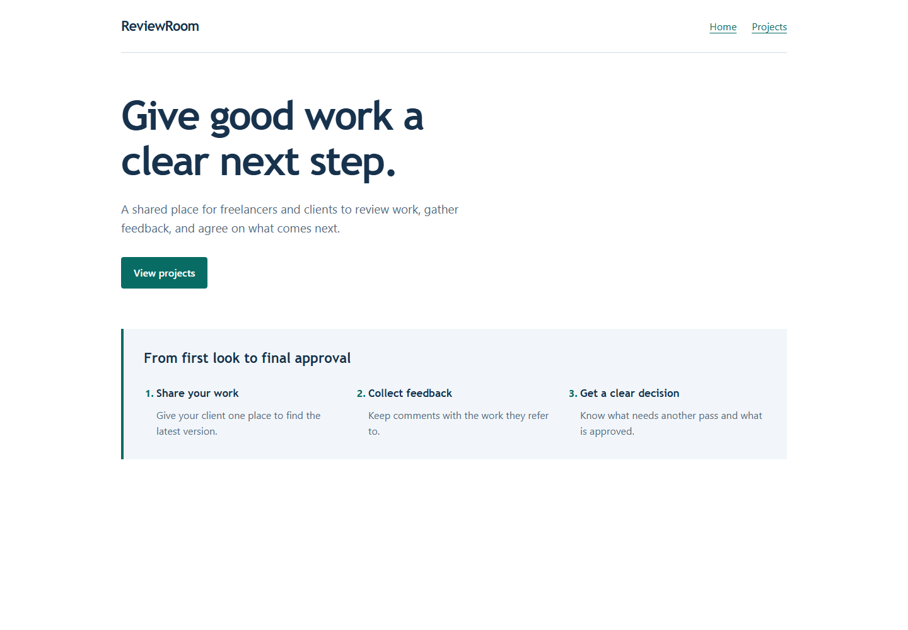
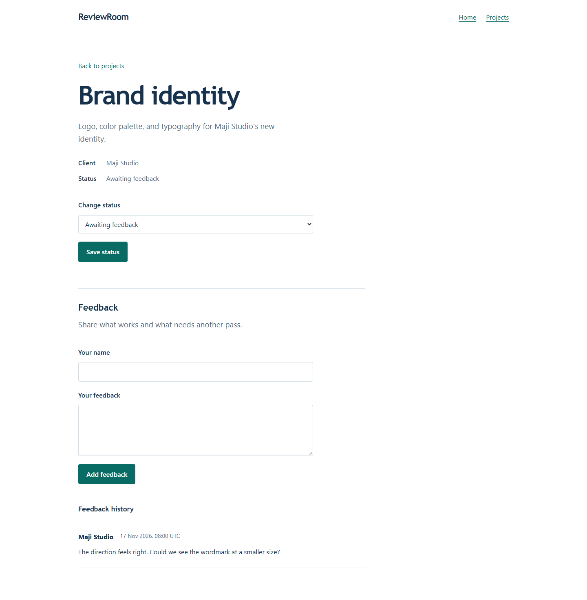
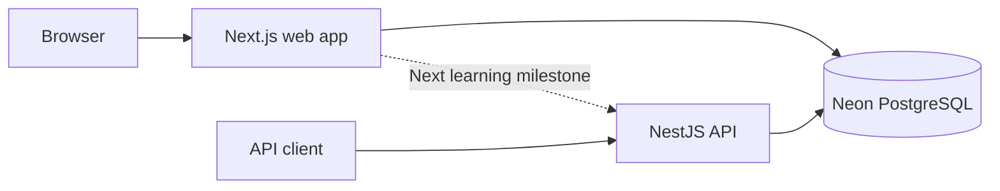

# ReviewRoom

**Give good work a clear next step.**

[](https://github.com/adil-aad/reviewroom/actions/workflows/ci.yml)

[Live demo](https://reviewroom-opal.vercel.app) · [API health](https://reviewroom-api.vercel.app/health) · [Projects API](https://reviewroom-api.vercel.app/projects)

ReviewRoom is a client feedback and approval portal for freelancers and small
studios. Create a project, collect feedback beside the work, and move it from
**Awaiting feedback** to **Approved**.

Built with **Next.js**, **React**, **NestJS**, and **Neon PostgreSQL**, this
repository follows a working application from its first React pages to a
separate backend, one validated milestone at a time.



## What you can do

- Create projects with a name, client, and description.
- Open a dedicated page for each project and update its approval status.
- Collect project-specific feedback with author names and timestamps.
- Filter projects through a shareable URL, including browser Back and Forward.
- Get useful validation messages, pending states, loading screens, and error recovery.
- Persist records in Neon, or use local JSON files when developing the web app.
- Read the project list and individual projects through the NestJS API.

The public deployment uses a separate database with sample data. This is a
learning-stage application: feedback names are display names, and authentication
and project access permissions are planned.

<details>
<summary>See a project review page</summary>



</details>

## Stack

| Layer | Technology | Responsibility |
| --- | --- | --- |
| Web application | Next.js 16 App Router, React 19, TypeScript | Pages, routing, interactive forms, Server Actions |
| Backend API | NestJS 12 | Project read routes, dependency injection, HTTP responses |
| Database | Neon PostgreSQL | Projects, feedback, constraints, related-record queries |
| Database access | Neon HTTP driver | Parameterized SQL without a persistent connection pool |
| Hosting | Vercel | Separate deployments for the Next.js app and NestJS API |
| Styling | Plain CSS | Responsive layout, accessible focus states, readable forms |

## Architecture



Next.js currently reads and writes project data directly. The NestJS API reads
the same data independently. Connecting the Next.js pages to that API is the
next milestone; creation, status updates, and feedback will move across later.

Server Components render the project pages. Client Components handle form
interaction with `useActionState`. Server Actions validate submissions, save
records, and refresh the affected pages through `revalidatePath`.

## Run locally

Use **Node.js 22.x** and npm. The commands work in PowerShell, macOS, or Linux.
In PowerShell, use `npm.cmd` if your execution policy blocks `npm.ps1`.

```sh
git clone https://github.com/adil-aad/reviewroom.git
cd reviewroom
npm ci
```

Start the web app:

```sh
npm run dev
```

Open the URL printed by Next.js, normally **http://localhost:3000**. Without a
database URL, the web app uses the included examples and saves new records in
the gitignored `.local-data/` directory.

### Connect Neon

Create a Neon database and copy `.env.example` to `.env.local` at the repository
root. Add its connection string as `DATABASE_URL`. Keep this variable on the
server; it must not have a `NEXT_PUBLIC_` prefix.

```dotenv
DATABASE_URL=your_neon_connection_string
DATABASE_URL_UNPOOLED=your_optional_direct_connection_string
```

Initialize the schema and import existing local records:

```sh
npm run db:setup
```

The setup runs in a transaction, preserves existing database IDs, and keeps the
original JSON files. Restart the web app after changing environment variables.
For a clean demo database containing only the example projects and feedback,
use `npm run db:seed-demo` instead.

### Start the NestJS API

In a second terminal:

```sh
cd backend
npm ci
cd ..
npm run api:dev
```

The API normally runs at **http://127.0.0.1:3001**. It reads the root `.env.local`
and `.env`, with process environment variables taking precedence. Its project
routes require Neon; `/health` works independently of database connectivity.
The backend emits native ES modules with TypeScript's `NodeNext` settings,
matching NestJS 12's package format and Vercel's runtime.

## API

| Method | Route | Response |
| --- | --- | --- |
| `GET` | `/health` | Server health JSON |
| `GET` | `/projects` | Project array, newest first |
| `GET` | `/projects/:id` | One project, or HTTP 404 |

```json
{
  "id": "brand-identity",
  "name": "Brand identity",
  "client": "Maji Studio",
  "status": "Awaiting feedback",
  "description": "Logo, color palette, and typography for Maji Studio's new identity."
}
```

Project IDs are strings: starter projects use readable IDs and new projects use
UUIDs. Database configuration and request failures return HTTP **503**, distinct
from a missing project's **404**. SQL-like text in an ID remains a parameter.

## Repository map

```text
src/app/                 Next.js pages, shared layout, and styles
src/app/projects/        Project UI, Server Actions, and current data stores
backend/src/             NestJS entrypoint, health endpoint, and projects module
db/                      PostgreSQL schema and example project seed
scripts/                 Database setup and demo initialization
docs/LEARNING.md          Detailed explanations of each completed milestone
```

The database schema models one project with many feedback entries. Foreign keys
keep feedback attached to existing projects, checks enforce text lengths and
allowed statuses, and an index supports ordered feedback queries.

## Validate and build

```sh
npm run typecheck
npm run build
npm run api:typecheck
npm run api:build
```

For production-style local runs, use `npm start` for the web app and
`npm run api:start` for the built backend. Stop development servers first to
avoid using the same ports twice.

Milestone checks have covered creation, approval changes, feedback validation
and persistence, URL filters, database constraints and imports, and live NestJS
responses against Neon. Database failures and recovery are checked separately
from missing records. Each completed milestone has a focused Git commit.

## Deploy to Vercel

Create two Vercel projects from this repository:

| Project | Root directory | Framework |
| --- | --- | --- |
| Web application | Repository root | Next.js |
| API | `backend` | NestJS |

Set **`DATABASE_URL`** in both projects before deploying. Use a dedicated
database for the public demo and initialize it with `db:seed-demo`. Vercel needs
database storage; the web app's local JSON mode requires a persistent writable
disk and is intended for local development.

Vercel detects the API's `src/main.ts` entrypoint and provides its listening
port. Both projects use Node.js 22.x. See [the NestJS hosting guide](https://vercel.com/docs/frameworks/backend/nestjs)
and [the Next.js hosting guide](https://vercel.com/docs/frameworks/full-stack/nextjs).

The live projects are connected to GitHub with the root directories above.
Pushing `main` triggers production deployments; pull requests can get preview
deployments. The public demo shares sample data and uses its own Neon branch.

## Learn from the code

[The learning guide](docs/LEARNING.md) explains Server and Client Components,
dynamic routes, Server Actions, revalidation, loading and error boundaries,
URL state, PostgreSQL persistence, and NestJS controllers, services, and modules
using the actual project files.

Start with the [projects controller](backend/src/projects/projects.controller.ts),
follow its injected [service](backend/src/projects/projects.service.ts), then
compare that request with the [Next.js project page](src/app/projects/[id]/page.tsx).

## Next milestones

- Connect Next.js project reads to the NestJS API.
- Move project creation, status changes, and feedback into the backend.
- Introduce authentication and project-level permissions.
- Add schema migrations and broader automated integration coverage.
